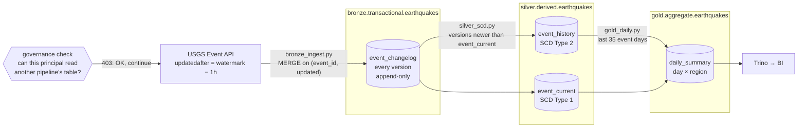
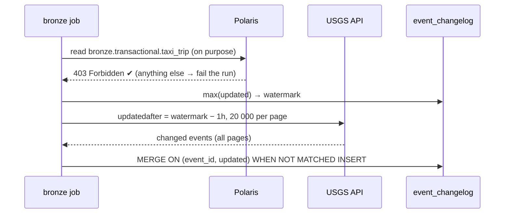
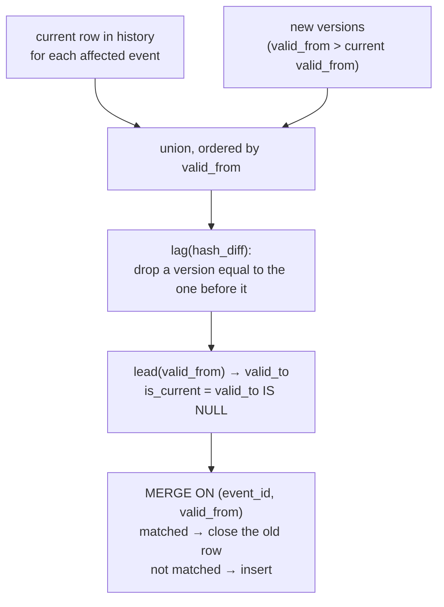
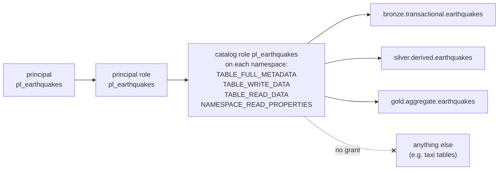

# earthquakes — incremental CDC → SCD Type 2 / Type 1 → daily summary

A daily pipeline that pulls every earthquake the [USGS](https://earthquake.usgs.gov/fdsnws/event/1/)
has **added or revised** since the last run, keeps every version it ever saw,
and turns that into a full change history (SCD Type 2), a latest-state table
(SCD Type 1) and a per-day summary for dashboards.

USGS is a good source for this because its data genuinely changes after the
fact: an event is first published from automatic processing, then revised —
magnitude, location, status `automatic` → `reviewed` — hours or days later.
Every revision bumps the event's `updated` timestamp, which is what this
pipeline captures.

| | |
|---|---|
| Source | USGS FDSN Event API, public, no key |
| Schedule | daily 10:30 Asia/Bangkok (DAG `usgs_earthquakes`) |
| Engine | Spark 4.0.1 on Kubernetes, Iceberg 1.11 tables via Apache Polaris |
| Runs as | Polaris principal `pl_earthquakes` — this pipeline's tables only |
| DAG | `vpn-data-platform-apps/dags/earthquakes/` |

## Flow



Three Airflow tasks, each its own SparkApplication:

| Task | File | Reads | Writes |
|---|---|---|---|
| `bronze_cdc` | `bronze_ingest.py` | USGS API | `event_changelog` |
| `silver_scd` | `silver_scd.py` | `event_changelog` | `event_history`, `event_current` |
| `gold_daily` | `gold_daily.py` | `event_current`, `event_history` | `daily_summary` |

`common.py` holds the catalog wiring, table names and the list of tracked columns.

## 1. Incremental load and CDC — `bronze_ingest.py`



- **Watermark from the table itself.** The newest `updated` already in the
  changelog. It moves only when a MERGE has committed, so a run that fails
  half-way leaves it untouched and the next run re-reads the same window. No
  separate state to drift out of sync.
- **One hour of overlap.** Each run re-reads an hour before the watermark;
  the MERGE key `(event_id, updated)` drops what is already there. Re-running
  any window is a no-op.
- **Query-based CDC.** Each distinct `updated` value of an event is one
  version. This captures inserts and updates. **It cannot capture deletes** —
  an event USGS removes simply stops appearing. That is inherent to pulling
  from an API rather than reading a database log.
- **Event-time window.** The API also applies an event-time filter; the job
  asks for events up to 30 days older than the watermark. A revision to an
  event older than that is not seen.
- **First run** reads the last 3 days. **`--since`** (DAG param `since`)
  re-reads from any point in time, for recovery or a deliberate backfill.

Bronze adds lineage columns to every row: `_ingested_at`, `_run_id` (the
SparkApplication name) and `_source`.

## 2. SCD Type 2 and Type 1 — `silver_scd.py`

Input: changelog versions newer than the newest `updated` in `event_current`.
`event_current` is written **last**, so a failure between the two tables makes
the next run re-process the same versions — and the history MERGE, keyed on
`(event_id, valid_from)`, does not duplicate them.

**Which changes open a new version.** A hash (`hash_diff`) over the tracked
columns: `mag, mag_type, place, latitude, longitude, depth_km, status, alert,
tsunami, event_type`. `updated` is deliberately not among them — USGS bumps it
for edits this model does not represent, and each would otherwise open a
version identical to the last.

**Example** — one event, four API versions:

| `updated` | mag | status | → `event_history` |
|---|---|---|---|
| 09:30 | 4.5 | automatic | row 1, valid 09:30 → 14:30 |
| 14:30 | 4.7 | reviewed | row 2, valid 14:30 → 18:30 |
| 16:00 | 4.7 | reviewed | *no row — nothing tracked changed* |
| 18:30 | 4.5 | reviewed | row 3, valid 18:30 → `NULL`, `is_current = true` |

`event_current` holds one row for this event: the 18:30 version.

How the MERGE is staged (per batch):



Rows that fail basic quality rules (missing event time; magnitude, latitude or
longitude out of range) are dropped **and counted** in the task log.

## 3. Gold — `gold_daily.py`

Per **event day × region** (`region` = the part of `place` after the last comma):

| Column | Meaning |
|---|---|
| `events`, `max_mag`, `avg_mag`, `m5_plus` | count and magnitude of earthquakes that day |
| `reviewed_share` | share already reviewed by a seismologist |
| `revised_events` | events with more than one distinct state in history |
| `avg_mag_revision` | mean of (latest magnitude − first reported magnitude) |

The last two only exist because of the SCD Type 2 history.

Each run rebuilds the **last 35 event days** and replaces exactly those
partitions (`overwritePartitions`). That covers every day a revision from the
30-day window could touch; older days are not rewritten.

## 4. Partitioning

Iceberg hidden partitioning — queries filter on the natural column and get
pruning without knowing the partition scheme.

| Table | Partitioned by | Why |
|---|---|---|
| `event_changelog` | `days(_ingested_at)` | append-only; "what arrived on day X" stays one partition |
| `event_history`, `event_current` | `days(event_time)` | queries ask about when quakes happened |
| `daily_summary` | `event_date` | one partition per dashboard day; rebuilt by partition |

## 5. Access control

The pipeline runs as Polaris principal **`pl_earthquakes`**, created by
`VPN_DATA_PLATFORM/bootstrap/pipeline_principal.sh earthquakes`:



- Grants are on the **namespaces**, so they cover every table the pipeline
  creates inside them and nothing outside. Nothing is granted at catalog level.
- Polaris vends S3 credentials from the asking principal's privileges, so the
  Spark pods cannot read another pipeline's files even through S3.
- The credential reaches the pods as Secret `spark/polaris-pl-earthquakes`; the
  shared `etl` credential is not mounted.
- **Checked on every run**: bronze deliberately tries to read
  `bronze.transactional.taxi_trip` and fails the run if Polaris allows it.

Layout follows `medallion.category.domain.table` from
`VPN_DATA_PLATFORM/docs/DATA_TIER.md`.

## 6. Failure and recovery

| What happens | Effect | Recovery |
|---|---|---|
| A task fails | Airflow retries once after 5 minutes | automatic |
| Bronze fails mid-run | watermark unchanged | the next run re-reads the same window |
| Silver fails between history and current | `event_current` not advanced | the next run re-processes; keyed MERGE prevents duplicates |
| Bad data landed | — | Iceberg snapshots: `CALL data_platform.system.rollback_to_snapshot(...)`, then re-run with `since` |
| Need to re-read history | — | trigger with `since = YYYY-MM-DD` |

The Spark driver's output streams into the Airflow task log; failed
SparkApplications are kept so the driver log can still be read.

## Running it

```bash
# once, after the platform is up (VPN_DATA_PLATFORM)
./bootstrap/pipeline_principal.sh earthquakes
```

Then in Airflow: trigger `usgs_earthquakes`, leaving `since` blank.

| Param | Default | Use |
|---|---|---|
| `since` | blank | blank = from the watermark; `YYYY-MM-DD[THH:MM]` (UTC) to re-read |
| `image_tag` | `0.2.0` | Spark image in Harbor |
| `pipeline_repo` / `pipeline_ref` | this repo / `refs/heads/main` | pin a run to a commit SHA |

## Querying (Trino)

```sql
-- how a quake's numbers changed over time
SELECT valid_from, valid_to, mag, status, place
FROM data_platform."silver.derived.earthquakes".event_history
WHERE event_id = 'us7000abcd'
ORDER BY valid_from;

-- what we knew at a point in time
SELECT event_id, mag, status
FROM data_platform."silver.derived.earthquakes".event_history
WHERE TIMESTAMP '2026-10-27 12:00:00' >= valid_from
  AND (valid_to IS NULL OR TIMESTAMP '2026-10-27 12:00:00' < valid_to);

-- the dashboard table
SELECT * FROM data_platform."gold.aggregate.earthquakes".daily_summary
ORDER BY event_date DESC, events DESC;
```

## Known limits

- Deletes at the source are not captured (query-based CDC).
- Revisions to events more than ~30 days older than the watermark are not seen.
- No quarantine table yet: rejected rows are counted in the log, not kept.
- Not yet scheduled: Iceberg maintenance (compaction, snapshot expiry) for
  these tables.
